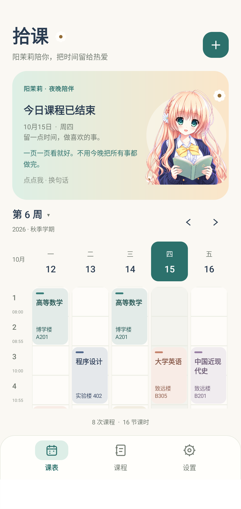
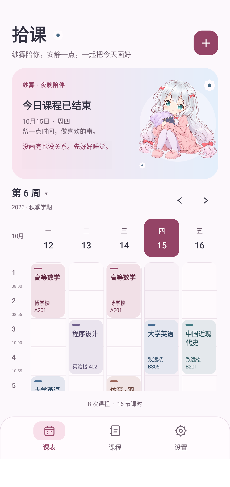
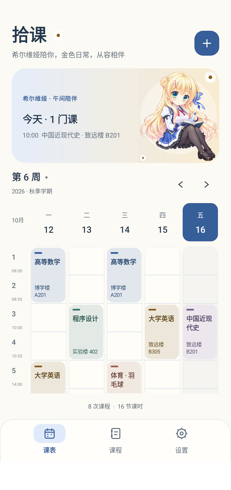

# 拾课

简洁的原生 Android 课程表，课程在本机保存，日常查看无需联网。使用 Kotlin 与 Jetpack Compose，支持 Android 8.0 及以上。

当前版本为 1.10.0。本机精简安装包位于 `dist/拾课-1.10.0-compact.apk`，源码压缩包位于 `dist/拾课-1.10.0-源码.zip`；`dist/` 不纳入 Git，拉取仓库后可以自行构建安装包。

「希尔维娅主题」现有 120 条原创陪伴语，其中早、中、晚各 38 句有离线日语配音，共 114 段，与阳茉莉使用相同的播放规则。一张原立绘与十五张重绘、蓝金浅深配色及小组件 Q 版继续保留。详见 [希尔维娅主题与素材](docs/希尔维娅主题与素材.md)。

阳茉莉与希尔维娅各有 114 段离线日语语音。点击换句后播放新句，播放结束前应用和小组件都锁定换句，不排队、不重叠；切到桌面或旋转屏幕继续播放。“播完再换句”仅在首次成功播放时提示，之后不再出现；播放锁继续生效。应用与所有小组件共用首次状态，升级、重启和换主题不重置。可在设置里关闭语音，纱雾主题继续静音。增量维护和系统中断规则见 [角色语音维护](docs/角色语音维护.md)。

## 安装与主题导入

基础安装包由102.05MB降至约1.29MB，减少98.7%，只含简约主题。三个角色主题已拆成独立ZIP，在「设置 → 导入主题包」选择、确认后即可使用，包含完整立绘、语录、配色和声音；可在「管理主题包」查看占用、替换或移除。

从旧版升级会保留课表，但原内置角色需要首次导入对应主题包。导入后可以删除原ZIP，后续更新应用不必重新导入。主题仍会占本机存储，外置主要减少基础包和每次应用更新的下载量。详见 [外部主题包与体积精简](docs/外部主题包与体积精简.md)。

## 继续开发

仓库：[KhronicleDavid/shike-timetable](https://github.com/KhronicleDavid/shike-timetable)。

```powershell
git clone https://github.com/KhronicleDavid/shike-timetable.git
cd shike-timetable
```

可以使用 Android Studio 打开项目，或按下方「构建」说明配置开发环境。修改后先构建和运行相关测试，再提交、推送到 `main`。课表、教务登录会话和签名密钥只保存在本机；仓库包含虚构示例与脱敏测试数据。

内置简约主题位于 `app/src/main/assets/themes/`，三个角色主题源文件位于仓库根目录 `theme-packs/`，每个主题有独立的 `theme.json`、图片与可选语音目录。运行 `python scripts/package-themes.py` 即可生成ZIP，导入后自动注册。立绘、分时语录、画册与配色从配置读取，方便增删内容；开发步骤和可复制模板见 [主题与角色素材维护](docs/主题与角色素材维护.md)。

「纱雾主题」包含雾白、樱粉与冰蓝的独立浅深配色、十二幅分时段适配图和 [126 条原创陪伴语](docs/和泉纱雾陪伴语.md)。1.6.1 新增温杯、伸懒腰与小哈欠各一组常规立绘及 Q 版，图片与增量维护说明见 [纱雾主题与素材](docs/纱雾主题与素材.md)。







## 功能

- 周课表：自动计算教学周、切换周次、突出今天、显示今日课程。
- 课程管理：添加、编辑、删除、搜索课程；支持教师、教室、备注、课程配色。
- 排课规则：1–12 节、1–30 周、单双周；准确检测实际教学周内的课程冲突。
- 学期设置：开学周一、学期周数、每日作息、周末显示。
- 外观：可在设置中切换「阳茉莉主题」「纱雾主题」「希尔维娅主题」和「简约主题」，应用和小组件共用整体主题；另支持浅色、深色和跟随系统。真白素材留待后续补充。
- 角色陪伴：阳茉莉有十六幅形象与 120 条原创陪伴语；纱雾有六幅常规立绘、六幅 Q 版与 126 条原创陪伴语。希尔维娅有十六幅形象与 120 条原创陪伴语。图片和台词按早、午、晚切换，支持关闭展示；纱雾小组件优先使用 Q 版。
- 点击互动：点击角色或语录区，只从实际早晨、午间或夜晚的对应池中换一句和一幅图，优先避开最近五句；切换页面、重建界面和普通小组件刷新保留选择，到下一半小时恢复自动轮换。换句提示在首次点击后永久隐藏，应用与小组件共用该状态。
- 桌面小组件：今日课程、教室、上课时间；课程多时上下滑动，可铺满横向并调节高度，点击课程打开详情，保存课表后自动刷新。
- 角色画册：按当前主题展示全部插画，阳茉莉十六幅、纱雾十二幅、希尔维娅十六幅；后续增减素材仅需维护主题配置。
- 数据：本机保存，通过系统文件选择器导入与导出 JSON 备份。
- 教务导入：电子科技大学官网内登录、读取课表、预览确认；也支持课表 HTML 文件和受支持的树维课表 JSON。

首次打开提供可编辑的示例课程。可以在「设置 → 清空课表」删除示例，再填写自己的课程；清空前可先导出备份。

## 构建

开发工具安装在 `E:\AndroidDev`，不改动系统的 Java 环境。需要迁移时可以传入其他路径。

构建脚本会为中文目录创建指向本项目的 ASCII 路径 Junction，解决 Windows 测试类路径编码问题，生成文件仍保存在本目录。

```powershell
# 下载并配置 JDK 17、Gradle 8.9、Android SDK 35
.\scripts\setup-environment.ps1

# 生成调试 APK 并运行业务测试
.\scripts\build.ps1

# 自定义工具目录
.\scripts\build.ps1 -DevRoot D:\AndroidDev

# Android 设备连接后运行界面测试与静态检查
.\scripts\build.ps1 -Tasks @('connectedDebugAndroidTest', 'lintDebug')
```

开发用APK位于 `app/build/outputs/apk/debug/app-debug.apk`；运行 `assembleRelease` 生成启用R8与资源裁剪的精简包，位于 `app/build/outputs/apk/release/app-release.apk`。本机沿用原有签名以便覆盖旧版，密钥不纳入仓库。

也可使用 Android Studio 打开本目录。将 Gradle JDK 设置为工具目录中的 JDK 17，并在 `local.properties` 配置 Android SDK 路径。项目已包含 Gradle Wrapper。

## 使用说明

1. 在「设置 → 当前学期」选定第 1 周的周一，填写总周数。首页随后自动计算当前周。
2. 点右上角 `+` 添加课程，选择星期、节次、上课周与单双周。
3. 点课表色块或课程列表卡片编辑，删除前需确认。
4. 点「第 N 周」可以跳转教学周，左右箭头逐周浏览。
5. 通过「设置 → 导出备份」保存 JSON；导入前显示确认，替换当前课程与设置。

一条课程记录表示一个固定的每周上课时段。同一门课程一周上两次时，分别添加两条排课记录。

课程管理无需注册拾课账号。教务导入使用联网权限，文件导入导出使用 Android 系统文件选择器，无需申请存储权限。重装或清除应用数据前请导出备份。

## 从电子科技大学教务系统导入

1. 打开「设置 → 从教务导入 → 打开学校教务系统」。入口为 [电子科技大学教务系统](https://eams.uestc.edu.cn/eams/)。
2. 在学校网页内自行登录，进入「课程管理 → 我的课表」，或点应用上方「我的课表」直接进入。选择需要的学期，并显示全部教学周。
3. 点应用底部「读取课表」，检查课程、教师、教室、星期、节次与周次。
4. 核对学期名称、第 1 周的周一和总周数。具体上课时间沿用现有作息，可展开查看，之后在「设置 → 上课时间」调整。
5. 点「确认替换并导入」。只有确认后才替换当前课程，取消或读取失败不会改变原课表。

Android 应用需要在自己的网页登录；电脑 Edge 登录状态不会搬入应用。拾课不采集登录表单中的账号或密码。登录会话仅在本机用于连接学校官网；兼容页面加载器使用本应用 WebView 的会话加载学校 HTTPS 页面，关闭导入界面会清理该会话。原始网页和会话不写入课表备份。

1.1.1 版默认开启「电脑版」：以当前 WebView 内核对应的桌面 Chrome 标识请求网页，并让教务页面使用 1280 像素的桌面布局，可双指放大浏览。上方「电脑版」按钮可切回手机布局，切换会刷新当前页面；不会清理登录会话。学校认证页面沿用自己的布局视口。设置依据见 [Android WebSettings](https://developer.android.com/reference/android/webkit/WebSettings)。

如果访问验证停留、网页空白或手机 WebView 无法登录，可在正常浏览器登录并打开完整学期课表，保存课表 HTML，传到手机后选择「从课表文件导入」。文件限制为 2 MB，支持 UTF-8、带 BOM 的 UTF-16，以及声明 GBK/GB2312/GB18030 的 HTML；拾课备份仍使用原有「导入备份」入口。

解析优先读取网页已经计算好的教学周，支持单双周、离散周次、分段换教室、同格多门课程和未指定教室的课程。应用把离散周次拆成精确排课记录，因此排课条数可能多于课程门数。无法完整表达的第 13 节及以上或第 31 教学周及以上会拒绝导入，不截断安排。

已通过用户登录后的 Edge 真实页面核实结构。之后在 Android 11 模拟器复现首页缺少脚本和样式的问题，并通过兼容页面加载恢复资源；用户随后确认课表能够读取。1.2.0 包含这一修复；仅教务整页 GET 使用兼容加载，登录 POST、AJAX 和子资源仍由 WebView 处理，证书检查和学校域名限制保留。研究依据与限制见 [教务导入研究](docs/教务导入研究.md)。

角色展示偏好在本机独立保存，课表 JSON 格式保持兼容。关闭当前角色的陪伴开关后，首页保留今日安排，课程页和空状态恢复纯信息布局；画册仍可由你主动打开。

角色来源、素材及设计说明见 [阳茉莉视觉设计](docs/阳茉莉视觉设计.md)。原立绘由用户提供；九幅适配插画通过内置 imagegen 工具参考原立绘重绘，角色与原作版权归 SMEE。

小组件的添加、大小调整、更新限制与时段规则见 [桌面小组件与分时段陪伴](docs/桌面小组件与分时段陪伴.md)。可从「设置 → 桌面今日课表」添加，也可长按手机桌面空白处，从小组件列表中选择拾课。台词原文见 [阳茉莉陪伴语](docs/阳茉莉陪伴语.md)。

## 项目结构

- `app/src/main/java/com/shike/timetable/MainActivity.kt`：周课表、课程列表与应用状态。
- `app/src/main/java/com/shike/timetable/ui`：主题、编辑页与设置页。
- `app/src/main/java/com/shike/timetable/data`：模型、日期规则、冲突检测、本地存储与严格导入校验。
- `app/src/main/java/com/shike/timetable/importer`：不执行网页脚本的教务课表解析器。
- `app/src/test`：日期、单双周冲突、JSON 校验与持久化测试。
- `app/src/androidTest`：真实 Android 上的主要操作流程测试。
- `examples/示例课表.json`：可导入的示例备份。

## 验证

1.10.0通过87项JVM测试及Debug/Release两组Android Lint（均0错误、7项既有提示）。Android11和15验证外部ZIP导入、预览取消、损坏包拒绝、同版本更新、图片/配色缓存刷新、语音与主题移除；实际精简版通过系统文件选择器导入、播放锁与进程重启验证。1.9.0覆盖升级的课表、外观及提示偏好逐字节保持。主题图片和声音原样迁移，基础APK只含简约主题。

1.9.0 通过 83 项 JVM 测试和 Android Lint（0 错误）；在 Android 11、15 独立模拟器上验证希尔维娅 114 段声音解码、真实播放结束锁、连点保护、后台与界面重建、音频焦点暂停恢复及首次提示持久化。新主题语录、全部插画、画册、浅深配色与真实桌面小组件通过检查，阳茉莉语音及纱雾外观回归通过。最终安装包内新声音与清单逐字节核对，原有主题素材保持不变。

1.7.0 通过 80 项 JVM 测试、Android Lint（0 错误），以及 Android 11 / API 30 与 Android 15 / API 35 上的真实语音流程：114 段音频均可在 Android MediaPlayer 读取；验证播放完成前禁止换句、桌面播放、旋转与后台保持、临时声音占用暂停及恢复、静音偏好和纱雾静音。纱雾外观及真实小组件回归通过。原训练录音、个人课表与登录信息不纳入仓库。

1.6.1 素材扩充通过 78 项 JVM 单元测试，以及独立 Android 11 / API 30 模拟器上的纱雾外观和真实小组件两项完整流程。逐项解码与打开十二幅插画，验证主题选择持久化、按时段换句及课程数据不变。1.6.0 的十项主题回归和 130% 字号验证记录仍保留。

课程 CRUD、脱敏课表逐周逐节比对、导入预览与确认、WebView 提取和电脑版布局等历史验证记录保留在验证文档中；本次素材更新没有重复访问学校的真实登录会话。

APK 已实际安装并启动，Android Lint 检查为 0 个错误。详细结果见 `验证记录.md`。

## 开源参考

周视图的时间轴与按天排列思路参考 [android-week-view](https://github.com/tobiasschuerg/android-week-view)，懒加载课程网格的交互参考 [LazyTimetable](https://github.com/MoyuruAizawa/LazyTimetable)。本项目独立实现课表 UI 与业务规则，没有复制这些项目的代码或素材。

教务格式参考学校公开的 [TaskActivity.js](https://eams.uestc.edu.cn/eams/static/scripts/course/TaskActivity.js) 和开源项目 [uestc-coursetable-parser](https://github.com/Saafo/uestc-coursetable-parser)。解析器独立实现，不复制这些项目代码；源码中的课表样本已脱敏或完全虚构。

运行依赖使用官方发布的 Kotlin、AndroidX、Jetpack Compose 与 Material 3；版本在 Gradle 文件中固定。构建脚本使用官方仓库，并提供阿里云镜像备用地址。
